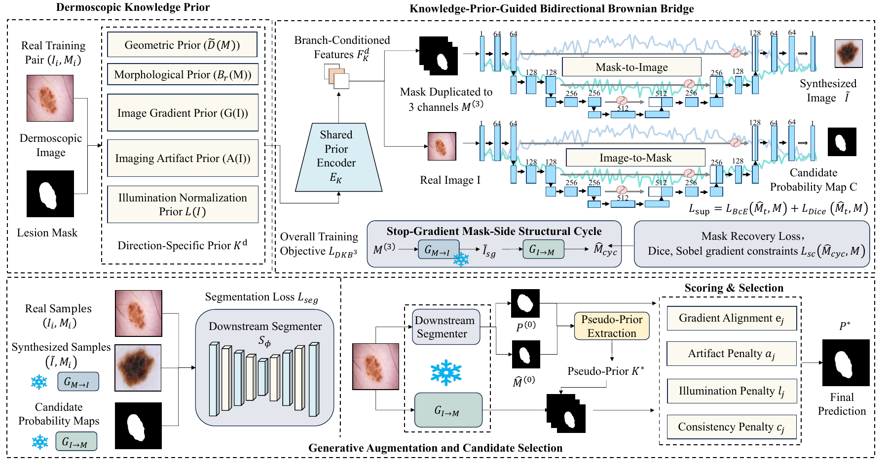

# DKB³

## Dermoscopic Knowledge-Guided Bidirectional Brownian Bridge Augmentation for Skin Lesion Segmentation

PyTorch implementation for DKB³ (Medical Image Analysis).

**Authors:** Hefeng Ji, Jing Xiao, Jimin Liu, Haoyong Yu, and Zihan Peng.
**Affiliations:** South China Normal University; National University of Singapore; Guangdong University of Technology.

[中文说明](README.zh-CN.md) · [Framework](assets/fig_overview.pdf)

## Overview

DKB³ uses two independently parameterized Brownian bridges and a shared five-channel prior encoder. The mask-to-image bridge produces reference-conditioned, mask-anchored appearance variants. The image-to-mask bridge produces stochastic mask candidates. Knowledge-guided candidate selection (KCS) ranks candidates using the observed image and an initial segmentation prediction, without ground-truth annotations.



The five prior channels represent signed distance, a boundary band, image gradients, hair/specular artifacts, and illumination. Synthesis uses paired image-derived appearance cues; it is not unrestricted mask-only image generation.

**This repository contains DKB³ only.** Downstream segmentation architectures, comparison methods, native baseline adapters, and paper-analysis scripts are not bundled. A downstream predictor is supplied externally when using online refinement. The required Brownian bridge implementation remains under `vendor/diff_bbdm`; it is a runtime dependency of DKB³.

## Structure

```text
DKB3/
├── dual_bbdm/
│   ├── models.py          # Dual bridges, prior encoder, branch adapters
│   ├── priors.py          # Five-channel dermoscopic priors
│   ├── losses.py          # Mask and boundary losses
│   ├── dataset.py         # Paired training data and manifests
│   ├── kcs.py             # Image-guided candidate scoring and selection
│   └── inference.py       # Refinement of external probability maps
├── vendor/diff_bbdm/      # Required bridge runtime
├── configs/              # ISIC2016 / ISIC2018 starter configurations
├── assets/               # Framework figure
├── tools/                # Split checks and source audit
├── tests/                # CPU tests
├── build_manifest.py
├── train_dual_bridge.py
├── export_bridge_artifacts.py
└── refine_masks.py
```

## Installation

Python 3.10 is recommended. Install a compatible PyTorch/torchvision pair for your hardware, then:

```bash
cd DKB3
python -m pip install -r requirements.txt
python -m unittest discover -s tests -v
```

PIQ may download perceptual-network weights when the bridge is first constructed; these weights are not bundled. The default `attention_type: att` does not require FlashAttention. Run commands from the repository root. The bridge resolver defaults to the bundled runtime, not the author's surrounding workspace.

## Data preparation

Obtain images and annotations under their original access terms. No datasets, historical case lists, synthetic images, or checkpoints are included.

| Dataset | Training | Validation | Test |
| --- | ---: | ---: | ---: |
| ISIC2016 | 720 | 180 | 379 |
| ISIC2018 | 2,594 | 100 | 1,000 |

These are the current manuscript splits; the portable templates are not verified historical experiment configurations. Validation/test cases must be excluded from bridge training and training augmentation.

```text
datasets/ISIC2018/
├── train/images/   train/masks/
├── val/images/     val/masks/
└── test/images/    test/masks/
```

```bash
python build_manifest.py --image-dir datasets/ISIC2018/train/images --mask-dir datasets/ISIC2018/train/masks --output data/isic2018_train.jsonl
```

Build validation/test manifests similarly, then run `tools/check_splits.py`. The default mask suffix is `_segmentation`; use `--mask-suffix ''` for identically named pairs. See [Data manifests](data/README.md).

## Train the dual bridges

```bash
python train_dual_bridge.py --config configs/isic2018.yaml
```

The example uses 40 epochs, batch size 4, AdamW, learning rate `1e-4`, and AMP. The checkpoint is `outputs/bridge/isic2018/last.pt`. For ISIC2016, use `configs/isic2016.yaml` with its own data and checkpoint.

## Generate augmentation

```bash
python export_bridge_artifacts.py --config configs/isic2018.yaml --use-ground-truth-candidate --no-visualizations
```

Synthetic images are saved under `artifacts/isic2018/synthetic_images/`. With this option, `candidate_masks/` contains the supplied training masks for compatibility, not newly predicted labels. Pair each synthetic image with its original training mask when training your own downstream segmentor.

The bundled sampling schedule is `[999, 1, 0]`, with **three network evaluations per sample**. Passing 12 to the old exporter does not create a 12-evaluation schedule.

## Refine an external prediction

Supply a lesion-probability map produced by your own segmentor: a 2D floating-point `.npy` array in [0, 1], aligned to the resized RGB image. The example grid is 256×256. Foreground means lesion, not background. Do not supply a ground-truth mask as the initial prediction.

```bash
python refine_masks.py --config configs/isic2018.yaml --checkpoint outputs/bridge/isic2018/last.pt --image examples/image.jpg --primary-probability examples/primary_probability.npy --output outputs/refined/case.png
```

The example input files are placeholders; they are not distributed. The command generates two image-to-mask bridge samples, includes their mean, and performs KCS. It writes a binary `.png`, selected `.npy` probabilities, and `.json` candidate scores. It does not load a segmentation backbone or compute GT metrics.

For external TTA candidates, repeat `--candidate NAME=PATH.npy`; probabilities must already be mapped back to the original image coordinates. TTA prediction itself belongs to your external segmentor.

For integration in your own PyTorch pipeline:

```python
from dual_bbdm import refine_masks

# system: loaded DualBridgeSystem in eval mode
# image: RGB float tensor [B, 3, H, W] in [0, 1]
# initial_probability: external lesion probabilities [B, 1, H, W]
selected_probability, candidate_scores = refine_masks(
    system, image, initial_probability, num_bridge_samples=2, bridge_steps=3
)
```

The interface requires no annotations. Four default score weights are `(edge, artifact, illumination, consistency) = (1.0, 0.5, 0.25, 0.5)`. The retained optional area penalty defaults to zero. Threshold 0.5 and the existing empty-prediction fallback 0.3 are configurable in the YAML.
